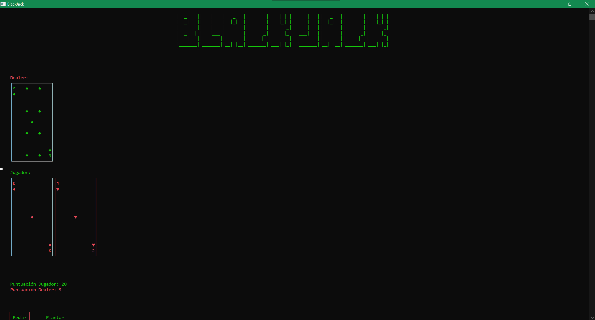

# BlackJack en C++ para terminal

[](https://github.com/IsokGta7/Black-Jack/actions/workflows/ci.yml)

Un juego de BlackJack escrito desde cero en C++17, con interfaz de texto en la terminal:
marcos con caracteres Unicode, colores, animaciones de revelado y un layout que se centra
según el tamaño de la ventana. Compila con `make` en Linux, macOS y Windows (MinGW-w64);
la integración continua compila el juego y corre las pruebas en los tres sistemas.



## Cómo se juega

El objetivo es acercarse más que el dealer a 21 sin pasarse. Las figuras valen 10 y el As
vale 11 o 1, lo que más convenga a la mano.

1. Al empezar recibes tus cartas y el dealer las suyas.
2. En tu turno eliges **Pedir** (otra carta) o **Plantar** (te quedas con tu suma).
3. Si te pasas del objetivo pierdes la mano; si llegas exactamente a él, la ganas.
4. Cuando te plantas, el dealer pide cartas hasta llegar a su mínimo (17 en el modo
   clásico) o al límite de cartas.
5. Gana la suma más alta; si el dealer se pasa, ganas tú. Con sumas iguales hay empate.
6. En la pantalla de resultados eliges volver a jugar o regresar al menú.

Controles:

- **Flechas arriba/abajo**: moverse por el menú y por las opciones de la partida.
- **Flechas izquierda/derecha**: cambiar el modo de juego en el menú principal y elegir
  opción en la pantalla de resultados.
- **Enter**: confirmar (`Pedir`, `Plantar`, `OK`, etc.).
- El menú principal ofrece *Jugar*, *Instrucciones*, *Créditos* y *Salir*.

## Modos de juego

El modo activo aparece debajo del título y en la pantalla de resultados.

- **Clásico**: objetivo 21, hasta 5 cartas por lado y el dealer se planta en 17. Si
  juntas 5 cartas sin pasarte, ganas la mano.
- **Práctica**: las mismas reglas, pero una derrota cuenta como empate.
- **Multironda**: serie al mejor de 3 manos; el marcador se conserva entre manos.
- **Mano corta**: objetivo 18, como máximo 3 cartas para ti y 4 para el dealer, que se
  planta en 16.

## Compilar y ejecutar

Se necesita un compilador con C++17 (`g++` o `clang++`) y `make`.

```bash
git clone https://github.com/IsokGta7/Black-Jack.git
cd Black-Jack
make            # genera bin/Blackjack
./bin/Blackjack
make test       # compila y corre las pruebas
make clean
```

- **Linux**: instala `g++` y `make` con el gestor de paquetes.
- **macOS**: las Xcode Command Line Tools traen `clang++` y `make`
  (`make CXX=clang++`).
- **Windows**: con MinGW-w64, por ejemplo desde MSYS2 (`pacman -S make
  mingw-w64-ucrt-x86_64-gcc`), ejecuta `make` en la terminal UCRT64. También se puede abrir
  `Blackjack.cbp` en Code::Blocks con un kit MinGW. Visual Studio (MSVC) no está
  soportado.

## Pruebas

`make test` compila `bin/tests/BlackjackTests` y lo ejecuta. Las pruebas usan
[doctest](https://github.com/doctest/doctest), incluido en `tests/doctest.h` con su
licencia MIT, y cubren la lógica sin interfaz: la suma con ases, que la baraja barajada
conserve las 52 cartas, cuándo pide y cuándo se planta el dealer, las reglas de cada modo,
la navegación del menú y de los resultados, y que todos los elementos del layout queden
dentro de la terminal en tamaños de 80x24 a 220x60. En Windows hay una prueba más, para la
traducción de las teclas extendidas de `_getch()`.

## Terminal y codificación

- Usa una terminal de al menos **100x30** caracteres con UTF-8 y una fuente monoespaciada
  que tenga caracteres de caja (`│─┐└╔╗╚╝`, `░▒▓`) y palos de baraja.
- En Windows el juego cambia la salida de la consola a UTF-8 e intenta ajustar el tamaño de
  la ventana. Si aun así ves símbolos extraños, ejecuta `chcp 65001` antes de iniciar.
- En Linux y macOS el tamaño de la ventana no se cambia; el layout se centra con códigos
  ANSI según el tamaño que reporta la terminal, y las flechas se leen como secuencias ANSI.
  Revisa que `LANG`/`LC_ALL` usen UTF-8.

Las animaciones se controlan con variables de entorno:

- `BJ_ANIMATIONS=off` o `BJ_DISABLE_ANIMATIONS=1` las desactivan (útil en consolas lentas
  o si la pantalla parpadea).
- `BJ_ANIMATION_DELAY_MS=5` fija el retardo de cada paso en milisegundos.

## Solución de problemas

- **Texto cortado o desalineado**: agranda la ventana a 100x30 o más antes de iniciar.
- **Símbolos extraños**: la terminal no está en UTF-8 o la fuente no tiene esos caracteres.
- **Code::Blocks no compila**: revisa que el kit MinGW esté instalado y seleccionado.
- **Cursor visible o pantalla sin limpiar en Linux/macOS**: la terminal no interpreta
  secuencias ANSI.
